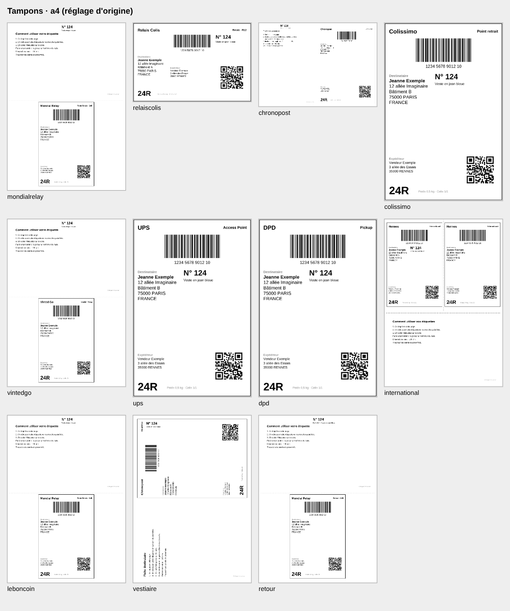
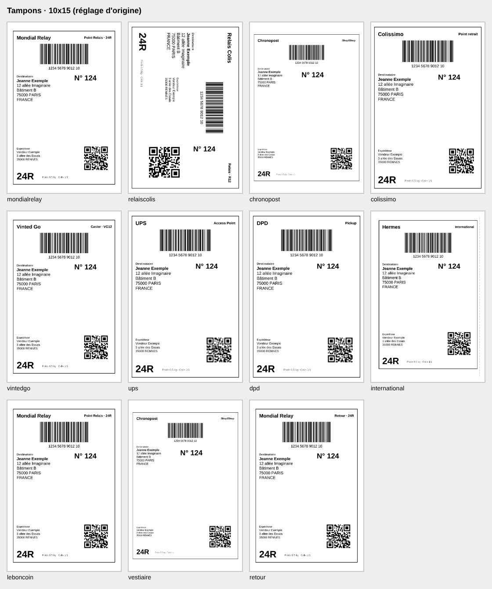
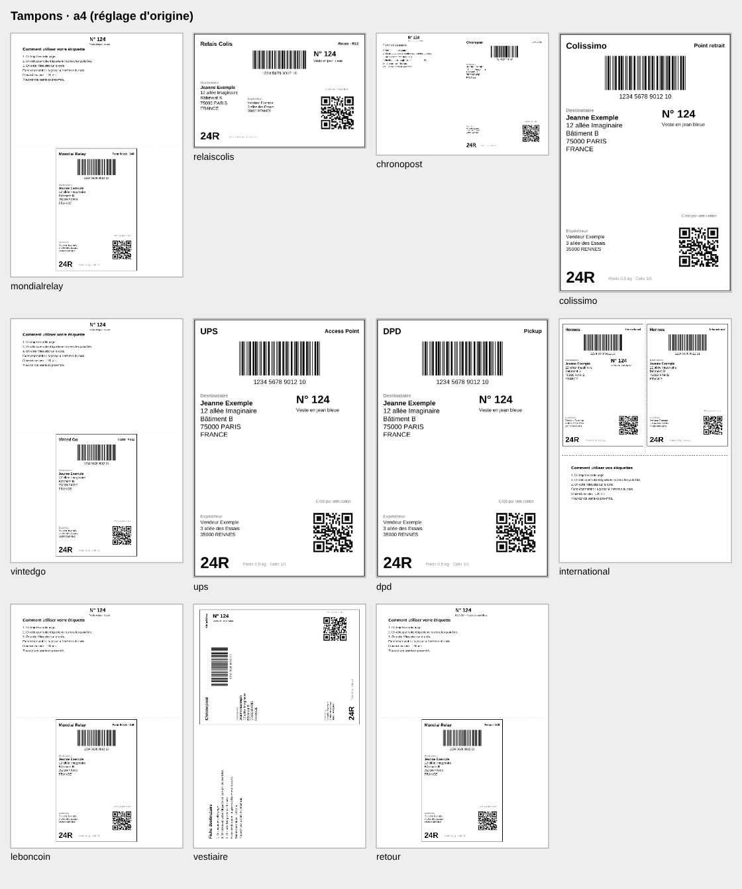
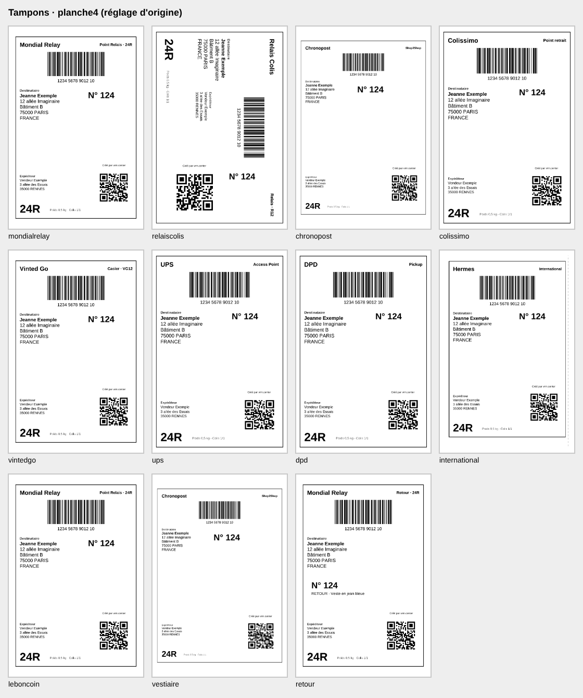
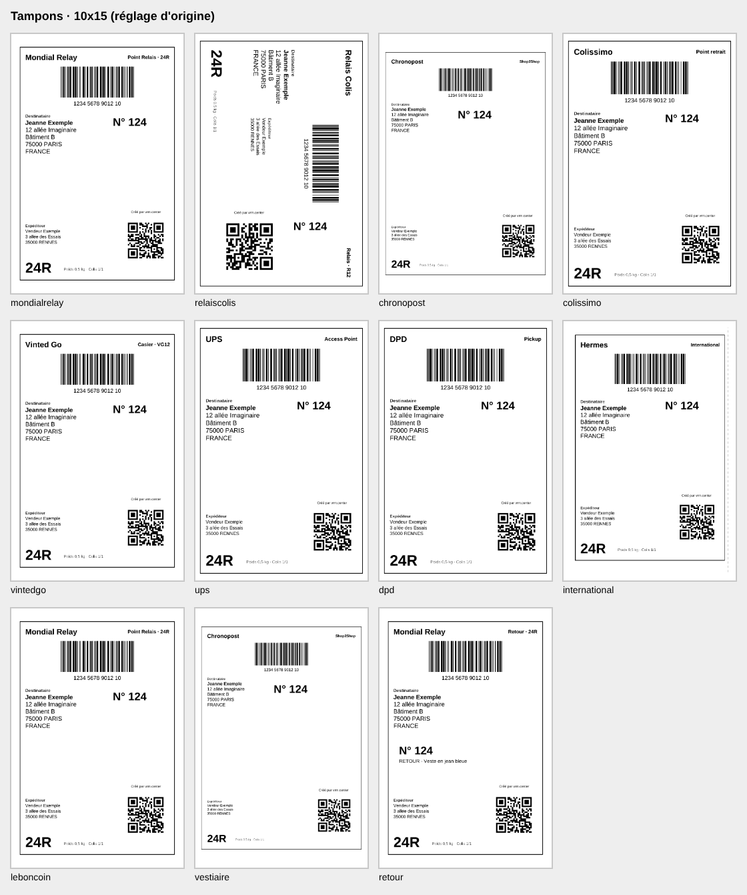
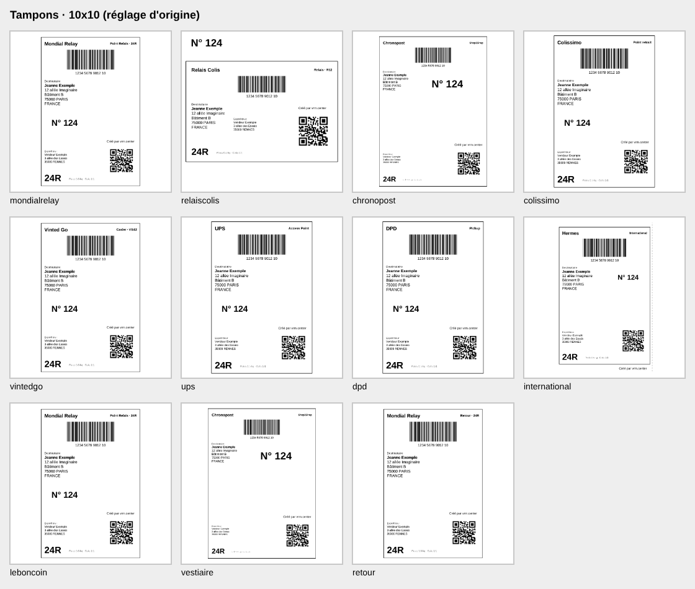
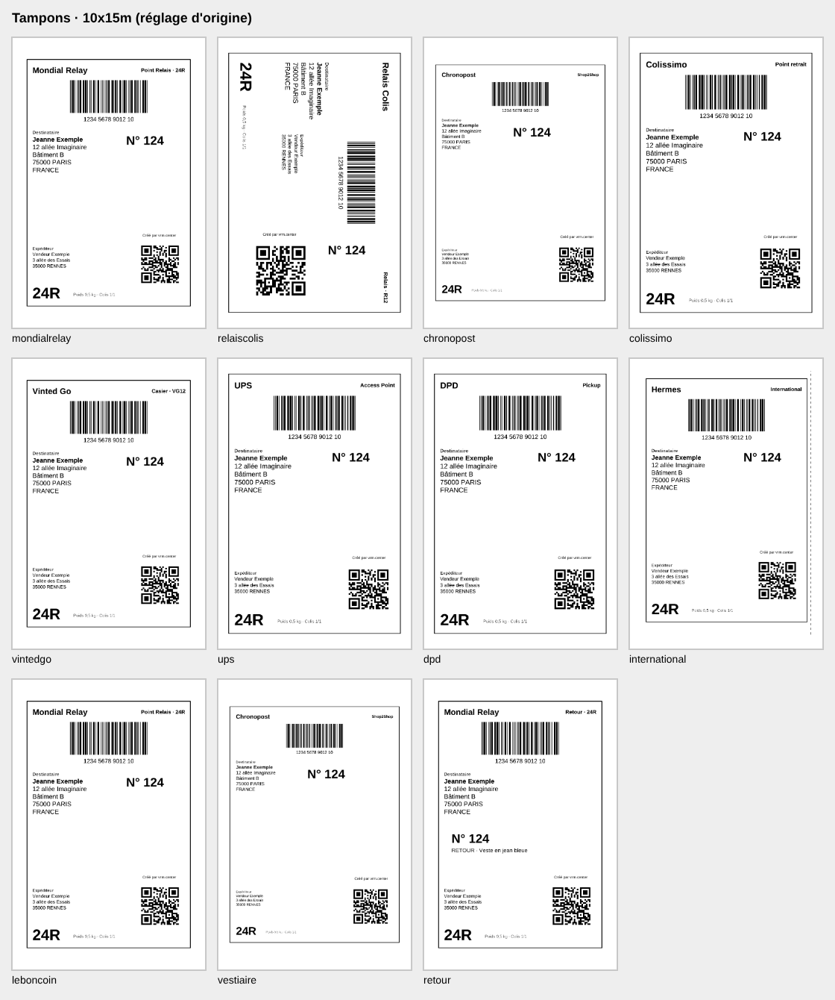
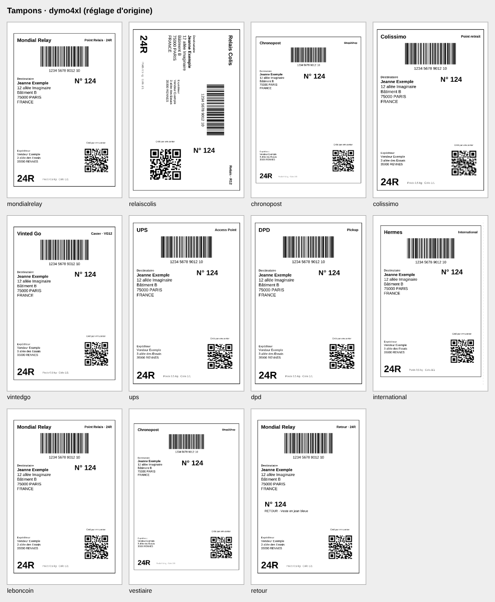
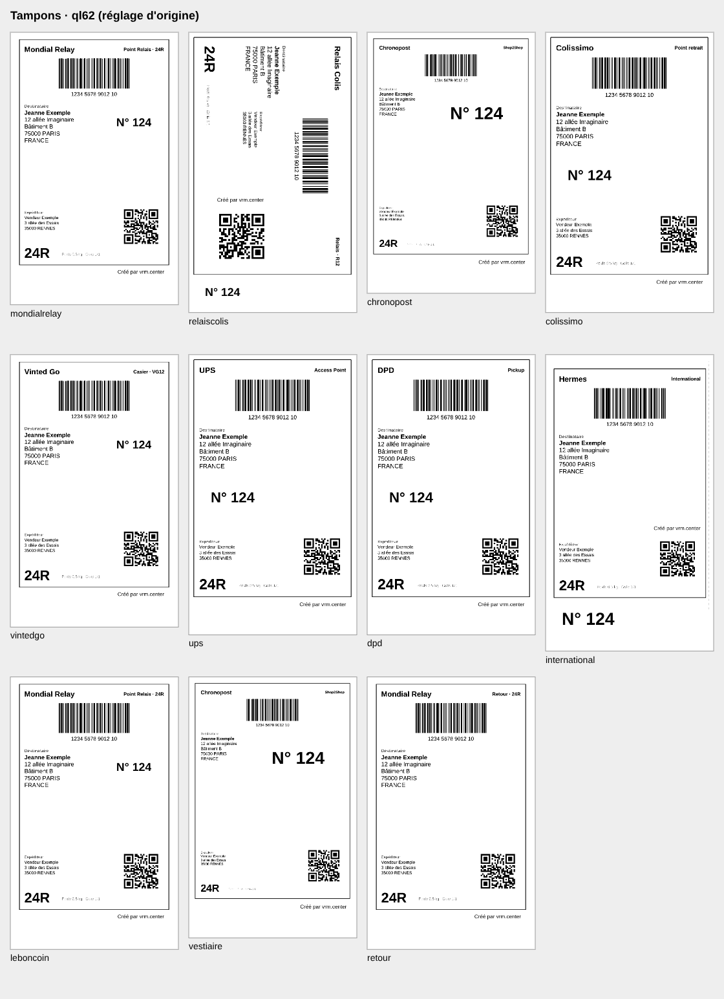

# 16 nov. 2026 — Les tampons des bordereaux : un réglage, l'aperçu avant impression, la mention au-dessus du QR

Branche `claude/tampons-parametres` (depuis `origin/main` du 16 nov.).

## Les demandes de Julien (mot pour mot, dans l'ordre ; les dernières priment)

1. « Je veux que tu améliores le processus de tamponnage pour que l'on puisse simplement y modifier tous les
   tamponnages ; je veux que dans un onglet dans les paramètres l'app montre à l'utilisateur tous les différents
   types/formats de bordereaux et où les tamponnages sont placés sur chaque bordereau ; tu dois tout faire parfaitement. »
2. « le Créé par vrm.center, c'est mal placé » ; « mets-le en dessous de l'adresse de livraison, je veux que ça soit au
   milieu sur le bordereau » ; « là où est le QR code » ; **DÉCISION FINALE** : « ou au-dessus du QR code, comme ça même
   si on met du scotch on le voit ».
3. « c'est pas mal, mais je ne peux pas le modifier juste visuellement ; je veux vraiment un visuel avec TOUS les
   bordereaux, que je peux modifier si jamais le tamponnage n'est pas au bon endroit ».
4. **PRÉCISION QUI PRIME** : « quand j'ai des bordereaux à imprimer, je sélectionne ce que je veux imprimer, et après ça
   m'ouvre une vignette avec un visuel un peu éloigné du bordereau, et le N° / le tamponnage je peux le régler là où je
   veux ; et quand je touche Imprimer, les réglages sont appliqués aux bordereaux ».

## 1. Inventaire (avant de coder) — ce que VRM tamponnait, et où

**UN chemin** pour toutes les impressions de l'app : `tamponnerBordereau` (App.jsx, « LE TAMPON DU BORDEREAU »), appelé par
`poserBordereau` (Tout imprimer / « Imprimer (N) », une vente, Leboncoin, Vestiaire, Stock), par le retour d'achat
(« RETOUR · … ») et par l'aide de l'équipe (`imprimerBordereauEquipe`). Le tamponnage serveur des e-mails
(`api/_lib/stamp.js`) n'est lu par personne (récit `2026-11-11-tampon-vrm.md`) ; l'extension ne tamponne pas (le PDF
Leboncoin passe par `pdfBordereauLbc`, lecture seule, puis par l'app). **eBay** : VRM n'imprime pas l'étiquette (eBay la
fournit, §2.8) — dit dans la galerie, rien à tamponner.

| type (le réglage les distingue) | reconnu par | forme d'exemple (inventée) |
|---|---|---|
| Mondial Relay · InPost | `typeBordereau` (mots, créateur) | A4 debout, notice en haut, étiquette 10×15 en bas |
| Relais Colis | « relais colis » | 150×100 couchée |
| Chronopost · Shop2Shop | « chronopost/shop2shop » (avant Colissimo) | A4 couchée, fiche à gauche, étiquette à droite |
| Colissimo | « colissimo » | 10×15 (la page est l'étiquette) |
| Vinted Go | « vinted go » | A4 notice + étiquette |
| UPS · DPD | `\bups\b` · `\bdpd\b` | 10×15 |
| International (Hermes, An Post, GLS) | mots, ou objet 100×150 posé | A4 à deux étiquettes côte à côte |
| Leboncoin | la plateforme (`site`) | A4 notice + étiquette Mondial Relay |
| Vestiaire Collective | la plateforme (`site`) | Chronopost en A4 couchée, /Rotate 270 |
| Retour (achat renvoyé) | le retour (`retour`) | A4 notice + étiquette, « RETOUR · … » |

Supports : **A4** (la page telle quelle), **4 par page** (les étiquettes isolées comme en thermique, rangées par quatre —
`planche4.js`), chaque papier **thermique** (`FORMATS_THERMIQUES` : 10×15, 10×10, 100×150 avec marge, Dymo 4XL,
Brother QL 62 mm continu, « Autre »).

**Placement d'avant** : le cartouche (N°, titre selon `vrm_impression.tamponA4/Th`) dans la PREMIÈRE zone blanche trouvée
sur le rendu (encre < 200, marges 5 × 3,5 mm), en thermique hors codes (+5 mm) et adresses ; sans place : fiche colis
(A4) ou fiche de préparation (thermique). Place à la main par forme (`vrm_tampon_positions`, feuille « Place du tampon »),
posée même sur un code (« rien n'est refusé »). La mention « Créé par vrm.center » : 6,5 pt gris 62 %, depuis le coin
**bas-droit** de la zone libre la plus basse, ≥ 25 mm du N°, **hors de l'étiquette à découper**, jamais sur une page
10×15 ni en thermique sauf dans le blanc AUTOUR de l'étiquette posée — c'est pourquoi elle tombait n'importe où (planche
« avant » ci-dessous), ou nulle part sur les 10×15.

## 2. Ce qui est fait

### Un seul réglage, toutes les impressions — `vrm_tampons` (src/impression/tampons.js, pur)
- `{ a4, th }` : le contenu « pour tous » (cases N° · titre · taille · « Créé par vrm.center ») en A4 et en thermique ;
  `texte` / `texteMention` (S 0,8 · M 1 · L 1,25) ; `place` (auto · coins · haut · bas) ; `placeMention` (`qr` = au-dessus du
  QR, bas, coins) ; `types[type]` : l'exception « seulement Mondial Relay » ; `formes[forme] = { n, m }` : les places
  posées à la main (fractions de la page affichée), par forme (type · format · sens [· tourné] [· thermique]).
- **Migration** : tant que `vrm_tampons` n'a jamais été écrit, `reglageTampons(null, { impression, positions })` reprend
  TELS QUELS `vrm_impression.tamponA4/Th` et `vrm_tampon_positions` (la place Chronopost tourné suit aussi Vestiaire).
- Lu par `reglageTamponsChoisi()` à CHAQUE impression : `poserBordereau` (A4 et thermique, Tout imprimer, une vente,
  Leboncoin, Vestiaire), le retour d'achat, l'aide de l'équipe (`tamponPourPage`) ; écrit par l'onglet, la liste courte
  « Tampon » de Paramètres → Impression (même source), « Toujours ici » de la feuille « Place du tampon », l'aperçu
  avant impression. SYNC_KEYS. L'empreinte d'un PDF préparé d'avance le compte (un changement ⇒ PDF refait).
- **Le RETOUR reste « RETOUR »** : N° et titre forcés, quelles que soient les cases.

### La mention à sa place (décision finale de Julien)
`placerMentionDefaut` : ① juste **au-dessus du QR**, centrée sur son axe, hors de sa zone de silence (4,5 modules mesurés,
3 mm au moins ; la boîte du QR est affinée sur ses vrais pixels) ; ② sinon juste **dessous** ; ③ sans QR : centrée sur
l'étiquette, première bande blanche **sous l'adresse** (blocs `zonesAdresse`), sinon sous la moitié haute ; ④ sinon rien.
Jamais sur l'encre (texte, cadre, trait), un code, une adresse ; posée AVANT le cartouche (qui l'évite de 4 mm) sauf
quand le cartouche est posé à la main. 6,5 pt gris foncé (0,42) en A4, 5,5 pt noir en thermique, × S/M/L.

### Le garde-fou inviolable
`zonesInterditesTampon` : chaque code-barres + 5 mm, chaque QR + sa zone de silence, chaque adresse repérée. Une place
posée à la main qui les chevauche est **repoussée** à la place libre la plus proche (`repousserHorsInterdits`, pur),
`repousse: true`, et l'éditeur le dit ; dans l'éditeur, un tampon lâché dessus est **refusé** (il revient, « Refusé :
ça recouvrirait le QR code »).

### L'APERÇU AVANT IMPRESSION (le cœur, demande 4)
« Imprimer (N) » (ou « Choisir » puis Imprimer, ou une série) ⇒ `lancerImpression` compose le lot (vrai code, vrais PDF) et
ouvre `ApercuAvantImpression` : une vignette par bordereau (`SceneTampons`), le N° et la mention se **glissent** (doigt,
souris, clavier), s'agrandissent (poignée, pincement), s'aimantent (centre, axe du QR, au-dessus du QR, bords) ; zones
interdites hachurées pendant le geste ; « N° / Mention à sa place d'origine » ; **« Appliquer à tous les bordereaux de ce
type »** (coché : la place est gardée pour la forme dans `vrm_tampons` ; décoché : pour CE bordereau, cette fois). Chaque
geste refait le PDF du lot (`composerLot(…, { places })`). **Rien ne s'imprime avant « Imprimer »** de l'aperçu
(`imprimerApercu`) : le PDF ouvert est celui de ces placements (signature `sigAvecPlaces`), dans le geste s'il est prêt,
la question §5 des N° « à vérifier » toujours AVANT (`numerosDemandent` / `attendrePuisOuvrir`).

### Paramètres → Imprimante et bordereaux → « Tampons des bordereaux »
`src/parametres/TamponsBordereaux.jsx` : la **galerie** de tous les types (eBay dit pourquoi il n'y est pas) sur le support
choisi (A4 · 4 par page · thermique + son papier), chaque vignette passée par `poserBordereau` avec le réglage ; toucher une
vignette ⇒ **le même éditeur** (`SceneTampons`) en grand, enregistré tout de suite, « Annuler », « Revenir à l'origine » ;
en complément les réglages en formulaire (cases, tailles S/M/L, places, « Tous » / « Seulement {type} ») et « Revenir au
réglage d'origine ». La raison de la place par défaut est écrite : « Au-dessus du QR code : visible même quand le scotch
recouvre le bas et les bords. »

Textes par `tr()` (src/i18n/langues/*/tampons.js, 5 langues). Quoi de neuf : `tampons-apercu`, `tampons-mention-qr`.

## 3. Preuves

### La mention : planches AVANT / APRÈS (rendues par le vrai code, regardées)
Bordereaux d'exemple de chaque type (formes reconstruites, aucune donnée réelle), imprimés par `poserBordereau` puis
rendus à 203 dpi (`scripts/bancs/tampons-reglages.cjs`, `CAPTURES=`) :

| | |
|---|---|
| AVANT (main) — A4 : la mention minuscule en bas à droite de la notice, loin de tout, ou nulle part |  |
| AVANT (main) — 10×15 : jamais de mention sur une page-étiquette |  |
| APRÈS — A4 |  |
| APRÈS — 4 par page |  |
| APRÈS — thermique 10×15 |  |
| APRÈS — 10×10 |  |
| APRÈS — 100×150 avec marge |  |
| APRÈS — Dymo 4XL |  |
| APRÈS — Brother 62 mm continu |  |

Compte du banc sur les 11 types × 7 supports (77 bordereaux) : AVANT **0 au-dessus du QR, 7 ailleurs, 15 absentes** (sur
A4 + 10×15) ; APRÈS **67 au-dessus du QR, 10 juste dessous** (dessus pris : Vestiaire tourné, Relais Colis couché,
étiquettes serrées), **0 ailleurs, 0 absente**. Vu sur les planches : un premier passage avait pris le code-barres agrandi
d'une Dymo pour un QR (mention au-dessus du code-barres) — corrigé (`alterneDeuxSens` : un QR alterne dans les deux sens),
puis un titre gras et « 24R » pris pour des codes (refus d'un tampon posé sur du texte) — corrigé (`estUnCode` : barres
pleines, ou QR sans ligne ni colonne vide, page tournée comprise).

### Bancs et tests
- **`tampons-reglages.cjs`** (vrai code, Chromium + pdf.js, 203 dpi) : **703 verts, 0 rouge** sur 11 types × 7 supports
  + les réglages. Par bordereau : QR décodé après tampons (jsQR, chaque QR d'une feuille à deux), code-barres lu (ITF),
  **aucun pixel changé** sur QR + 4 modules et code-barres + zone de silence (comparé au même sans tampon), mention
  écrite, **centrée sur l'axe du QR (écart ≤ 2 %)**, juste au-dessus (ou dessous) hors zone de silence (2,5–16 mm),
  petite (4,5–7,5 pt), N° écrit hors du QR, RETOUR marqué. Réglages : N° seul sans mention, taille L, place « bas-droite »,
  place à la main imprimée à cet endroit, place à la main SUR le QR repoussée (QR lu), mention SUR le QR repoussée,
  exception « seulement Mondial Relay », migration (`tamponA4`, `vrm_tampon_positions`), place de l'aperçu pour CE
  bordereau (avec un `choisir` comme le lot), RETOUR même tout décoché (A4 et thermique).
  - **Arbre d'avant** (`git archive origin/main`, banc copié) : **142 verts, 29 rouges** (mention absente ou ailleurs).
  - **Mutations** : `mentionSurQr` 45 rouges (QR touché, mention pas au-dessus) · `ignoreReglage` 9 rouges · `retourSansRetour`
    2 rouges · `sansRepousse` 2 rouges.
- **`tampons-apercu.cjs`** (app construite, 1512 souris et 390 tactile par vrais points de contact CDP) : voir « ÉTAT ».
- **`tampon-bordereau.cjs`** (CI) porté sur la nouvelle règle (mention au-dessus du QR, centrée ; référence sans tampon
  vraiment vide ; places dans `vrm_tampons`) ; mutation `mentionAveugle` : 18 rouges.
- **`thermique.cjs`** : 403 verts, 0 rouge (mutation `sansBloques` portée : les codes sont gardés deux fois).
- **`audit-tampons.cjs`** (neuf) : 20 verts ; `--prouve` 11/11 mutations rouges (SYNC_KEYS, ancien réglage relu, appel
  sans tampon, réglage ignoré, RETOUR, empreinte, impression sans aperçu, places ignorées ×2, repousser, textes).
- Portés sur la règle (Julien a changé le parcours : l'aperçu avant impression) : `impression-simple` (33 verts sur
  A, B, C), `tout-imprimer` (29), `selection-bordereaux` (49), `colis-plus`, `lot-bordereaux`, `lbc-bordereau`,
  `ventes-bordereau`, `vestiaire-parite`, `colis-a-leur-place`, `accompagnement`, `feuilles-coque`, `imprimante`,
  `tampon-libre` (son parcours est joué par `tampons-apercu`), `scripts/tests/lot-preparation-reprise.cjs` (vert),
  `scripts/tests/bordereau-qr-lecture.cjs` (règles d'impression jointes ; la 10×15 porte désormais la mention, le QR doit
  se lire), audits `impression`, `colis-plus`, `colis-trois`, `selection-bordereaux`, `impression-carton` (sa fenêtre de
  recherche était trop courte : rouge aussi sur main, réparé).

### Reprise du soir (16 nov., second passage)
- **`origin/main` fusionné** (vrai merge : barre-achats, vente-email-absente, passation générale) ; §9 de CLAUDE.md :
  les trois lignes les plus anciennes déplacées telles quelles dans `historique-divers.md`.
- **Défaut trouvé et corrigé : « Bordereau prêt » s'ouvrait SOUS la fiche.** Depuis Ventes « verre », un bordereau
  s'imprime seul par rangée ⇒ fiche ⇒ « ⋯ » ⇒ « Imprimer le bordereau » (les mêmes boutons, `DansFiche`). La fiche est à
  9000, sa feuille « ⋯ » à 9100 ; « Bordereau prêt » était à 1250 : invisible, son « Imprimer » ne se touchait pas
  (capture : la feuille « Plus » seule à l'écran). Ordre posé dans `src/impression/couches.js` : « Bordereau prêt » 9200,
  aperçu avant impression 9300 (« Déplacer le tampon » s'ouvre par-dessus), visionneuse 9500, « Mon compte » 10000.
- « Bordereau prêt » disait « Le PDF est ouvert dans un onglet » : il s'ouvre dans la visionneuse de VRM ⇒ « Le PDF s’est
  ouvert dans VRM. « Imprimer » le rouvre. » (5 langues).
- **Le retour jamais au tampon d'une vente** (contrôle neuf de `tampons-reglages`) : un retour est un Mondial Relay A4
  comme une vente ; la place posée à la main pour la forme d'une VENTE Mondial Relay et l'exception « seulement Mondial
  Relay » ne s'appliquent pas à lui (famille « retour », RETOUR écrit). Le banc fait désormais arriver le retour SANS
  famille, comme l'app (`retour: true`) ; mutation `retourPrendVente` (la règle `familleDe` affaiblie) ⇒ rouge.
- **Banc `tampons-apercu` renforcé** : S et B étaient ROUGES à la reprise (12 rouges sur l'arbre d'avant la reprise,
  b5718fc97) — mesure prise sous l'écran de démarrage, et le geste d'UNE vente cherché sur la ligne (il est dans la
  fiche). Maintenant : écran de démarrage parti, page posée 2 s avant de mesurer ; rangée ⇒ fiche ⇒ « ⋯ » ⇒ Imprimer ;
  le bouton ne change NI de taille NI de place (≤ 1,5 px) ; « Bordereau prêt » au premier plan (`elementFromPoint`) ;
  `TA_SOMBRE=1` pour le mode sombre. Résultat : **56 verts, 0 rouge** (clair) ; sombre P+B+E vert ; S stable 3/3.
  Mutation `Z_BORD_PRET = 1250` ⇒ 6 rouges (B2, B3 × 2 vues).
- Captures regardées (390 tactile et 1512, clair et sombre) : aperçu, glisser, refus sur le QR, Bordereau prêt, galerie,
  éditeur.

## Non fait, dit
- **Rotation du tampon** : pas proposée. Le cartouche s'écrit toujours dans le sens de lecture de la page (rotation /Rotate
  comprise) ; un tampon tourné à part serait moins lisible et compliquerait le garde-fou. À rouvrir sur sa demande.
- **Un bordereau imprimé seul** depuis sa carte (Ventes « Imprimer », Vestiaire, Leboncoin) garde la feuille « Place du
  tampon » d'avant (ouverte quand la forme n'a pas de place gardée) ; elle lit et écrit désormais `vrm_tampons`, et
  l'impression repousse un tampon posé sur un code. L'aperçu à vignettes est celui de la sélection (« Imprimer (N) »,
  « Choisir » ⇒ un seul coché).
- Sur un vrai PDF dont la police n'a pas de table ToUnicode, l'adresse n'est pas lisible : la mention « sous l'adresse »
  retombe alors sur « au-dessus du QR » ou la bande blanche du milieu (les codes restent protégés sur l'image).
- WebKit absent du conteneur : l'iPhone est simulé (agent, `window.event`).

## ÉTAT À LA REPRISE

- Branche `claude/tampons-parametres`, poussée, `origin/main` fusionné (vrai merge) ; PR ouverte (voir le rapport).
- Tout le code est là : `src/impression/tampons.js` (réglage, pur), `src/impression/SceneTampons.jsx` (la scène qu'on
  glisse), `src/impression/ApercuAvantImpression.jsx` (la feuille), `src/parametres/TamponsBordereaux.jsx` (galerie +
  éditeur), App.jsx (« LE TAMPON DU BORDEREAU » : mention, garde-fou, `tamponnerBordereau` ; `poserBordereau`,
  `tamponDePage`, `geoPageA4`, `tamponPourPage` ; moteur de Colis : `lancerImpression` → aperçu, `imprimerApercu`,
  `poserApercu`, `origineApercu` ; `ApercuUnCoque` pour un bordereau seul).
- **Fusion avec `claude/impression-retours` (PR #1194, ouverte)** : elle change aussi `tamponnerBordereau` (paramètre
  `retour`, cartouche RETOUR cerné) et le chemin du retour d'achat. Au merge : garder les DEUX (`retour` ET `tampon`),
  passer `tamponPourPage(PL, pdf, { famille: 'retour' })` au chemin du retour, et `impression.retour` reste ce qui fait la
  famille « retour » dans `poserBordereau` (RETOUR toujours écrit, `audit-tampons` T4).
- **`claude/impression-directe`** (« Imprimer les N » sans étape) contredit la précision de Julien qui prime ici (l'aperçu
  avant impression à chaque sélection) : à trancher par lui si les deux arrivent.
- CI : les jobs « Audits » sont rouges sur `main` (64 audits, PR #1196 en cours) ; ce lot n'en ajoute aucun (comparé
  audit par audit, `audit-notifs-redaction` rouge aussi sur `main`). Règle du 16 nov. : pas de fusion tant qu'un rouge reste.
- Geste de Julien : imprimer un vrai bordereau Mondial Relay et un Chronopost avec un N° et regarder la mention au-dessus
  du QR (aucun vrai PDF dans ce dépôt public : tout est prouvé sur des formes reconstruites).
