# Architecture, données et ordre de livraison

## Intégration existante

Base de travail inspectée : main publié avec PR577, commit `0beaaa565bab21553abb6ab2932a8413a72bfd2e`. Toujours récupérer main avant de coder : ce repère n'est pas une garantie de fraîcheur future.

| Élément VRM | Réutilisation / audit |
|---|---|
| `api/ebay.js`, `api/_lib/ebay.js` | Session, OAuth et identité de compte ; ne pas confondre scopes Sell et droits Buy |
| `api/_lib/ebay-agent.js`, `api/_lib/ebay-gestion.js` | Journaux et traitements existants à auditer, sans leur attribuer la veille d'achat |
| `src/ebayGestion.jsx`, `src/ebayParcours.js` | Conserver actions vendeurs et navigation existantes |
| `api/_lib/equipe.js`, `api/compte.js` | Appartenance/permissions existantes à prolonger |
| `supabase/migrations/016-equipe.sql` | RLS et projections limitées ; vérifier installation et version effective |
| `src/App.jsx` | Filtres, article, bénéfice, photos, vue équipe, recherche, stock et navigation à étendre |
| `scripts/bancs/equipe.cjs`, bancs eBay | Socle de non-régression, données synthétiques |

Le code n'a pas été modifié par ce dossier. Les anciens dossiers de passation restent des sources historiques ; leurs tâches non terminées doivent être confrontées à l'état actuel.

## Découpage proposé

```mermaid
flowchart LR
  Rules[Recherches et règles] --> Scheduler[Ordonnanceur persistant]
  Scheduler --> Read[Adaptateur lecture eBay]
  Read --> Facts[Faits normalisés et fraîcheur]
  Facts --> Match[Évaluation oui / non / inconnu]
  Match --> Decisions[Liste et décisions privées]
  Match --> Alerts[Alertes consenties]
  Decisions --> Review[Relecture actuelle]
  Review --> Assisted[Achat assisté]
  Review --> Gate[Capacité et mandat]
  Gate --> Budget[Réservation atomique]
  Budget --> Order[Adaptateur achat autorisé]
  Order --> Reconcile[Confirmation ou incertitude]
  Reconcile --> Reception[Mission de réception]
  Reception --> Stock[Contrôle puis stock]
```

Adaptateurs séparés pour recherche, détail, frais/destination, offre, commande et enchère. Chaque adaptateur annonce ses capacités prouvées : marketplace, pays, catégories, quantités, devise, autorisation et date du contrôle. Une capacité absente ne se transforme pas en résultat simulé dans l'app.

Ne pas faire dépendre la veille serveur d'un onglet ouvert sur le téléphone. Choisir un service de tâches durable compatible avec l'hébergement réel. Stocker les baux, échéances et résultats de travail hors mémoire du processus. Les tâches planifiées ne contiennent pas de jeton en clair.

## Entités proposées, non encore migrées

`watch_search`, `watch_rule_version`, `watch_candidate`, `watch_observation`, `watch_decision`, `alert_delivery`, `purchase_mandate`, `budget_ledger`, `purchase_attempt`, `task`, `task_step`, `task_assignment`, `task_evidence`, `reservation`, `purchase_lot`, `lot_allocation`, `supply_item`, `supply_movement`, `receiving_check`, `return_case`, `audit_event`.

Propriétaire non modifiable depuis le corps d'une requête, identité serveur, identifiants stables, dates serveur, versions et idempotence pour les écritures concernées. Une clé publique d'annonce n'autorise jamais la lecture d'une décision privée.

Les documents comptables et budgets nécessitent transactions et contraintes de base. Ne pas faire de réservation financière atomique à partir d'un simple `read → modification JSON → write` de `app_data` : deux clients pourraient dépenser le même solde.

Migrations additives, contraintes et RLS revues, bancs de transactions et scénarios de panne avant activation. Les projections d'équipe n'exposent pas les tables brutes d'achat, de comptes ou de conversations. Pour un abonnement ou un rôle, l'autorité reste serveur/base ; un bouton caché ne constitue pas une permission.

## États d'erreur à traiter dans le produit

Accès absent, autorisation expirée, collecte jamais commencée, données anciennes, requête trop large, pagination partielle, tarif de livraison absent, devise inconnue, capacité épuisée, événement dupliqué, écritures concurrentes, résultat commercial incertain, membre révoqué, migration absente, justificatif manquant. Aucun de ces états ne vaut automatiquement « aucun résultat », zéro, stock vide ou succès.

## Livraison par tranches vérifiables

### A — Lever les inconnues du bot

Vérifier le contrat Browse/Buy avec le compte développeur VRM réel, les marketplaces visées, les quotas et les usages de cache. Lire les offres concurrentes actuelles après rétablissement réseau. Produire des preuves datées. Aucun achat réel pour « tester » sans mandat spécifique.

Sortie : matrice de capacités et schéma d'erreurs validés ; affichage honnête des fonctions indisponibles.

### B — Veille utilisable

Recherches guidées, exigences par catégorie, moteur déterministe à trois états, collecte durable, premier import sans avalanche d'alertes, liste de décisions, pause, dernière lecture et alertes volontaires. D'abord un pilote limité aux capacités vérifiées ; pas une promesse de couverture universelle.

Sortie : utilisateurs pilotes réels avec accès appropriés, mesures de fraîcheur et de faux positifs, coût de requêtes observable.

### C — Délégation

Migrations de missions, droits, attribution, étapes, blocages, preuves privées, validation et récupération de colis. Étendre le mode équipe actuel. Tests de révocation et d'accès croisé avant exposition des codes.

Sortie : une mission peut être faite et validée de bout en bout ; aucun accès financier involontaire.

### D — Réservations et lots

Réservation atomique et expiration, acomptes enregistrés sans paiement automatique, source d'achat et ventilation exacte, réception partielle et export sans double compte.

Sortie : recette des centimes, quantités, courses entre clients et corrections après vente.

### E — Consommables et opérations

Journal de stock réel, unités, entrées/consommations/réservations, coût connu, seuils, modèles d'emballage ; contrôle qualité, numéros de série, retours et dossier comptable.

Sortie : aucune consommation répétée lors d'une réimpression ou reprise réseau, et inconnus visibles.

### F — Achat assisté et automatisation éventuelle

Achat assisté en premier. Automatisation seulement après preuve de capacités, mandats et budget atomique, réconciliation des résultats et pilote contrôlé. Offres et enchères sont des livraisons séparées, pas des cases cochées en réutilisant l'API Sell.

Sortie : une demande incertaine ne peut pas déboucher sur deux achats, et une pause empêche tout nouvel engagement.

### G — Compléments de confort retenus

Recherche globale étendue, vue article, bénéfice expliqué, actions groupées, synchronisation et expéditions, annulation locale, missions récurrentes et passation. Mesurer ce qui existe déjà avant chaque changement.

Chaque tranche doit livrer un parcours fonctionnel, les migrations nécessaires, ses refus et ses tests. Pas de boutons décoratifs ni de fonctions annoncées actives avant leur activation effective. La priorisation ne constitue pas une estimation de délai ; chiffrer après audit des contrats et de la base.
